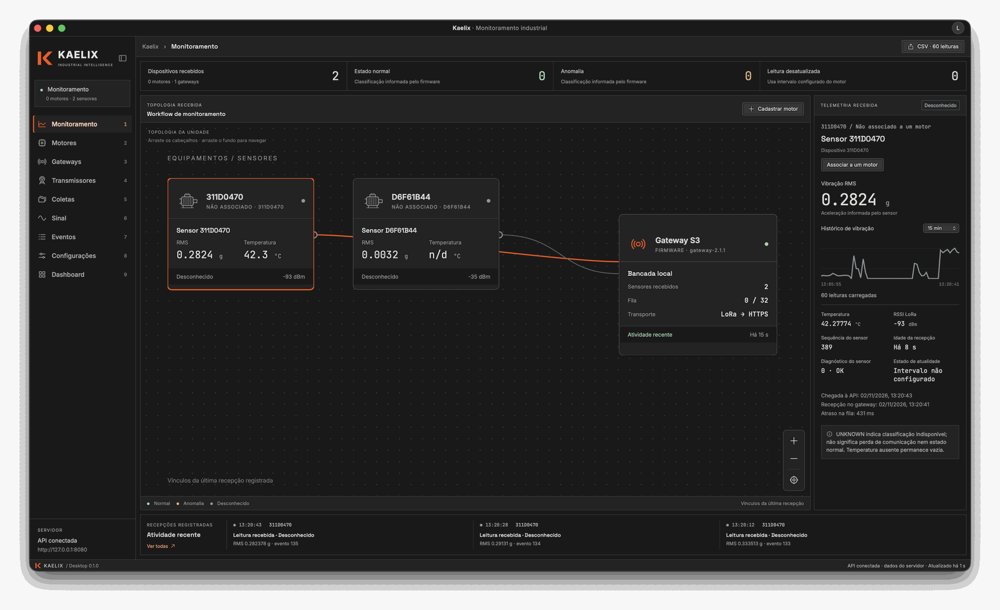
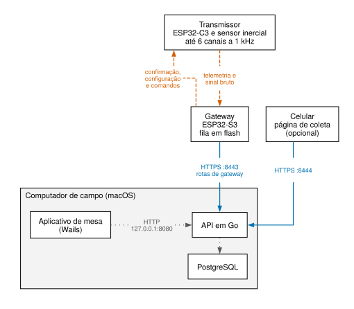
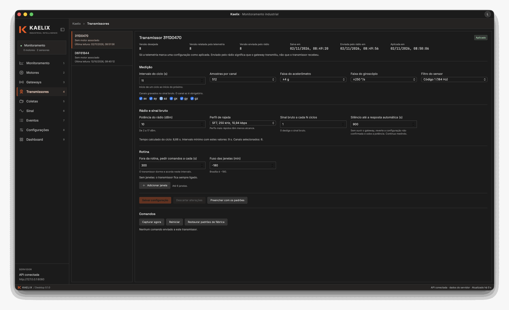
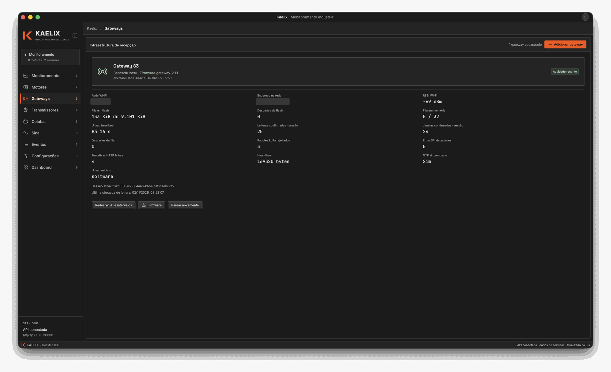
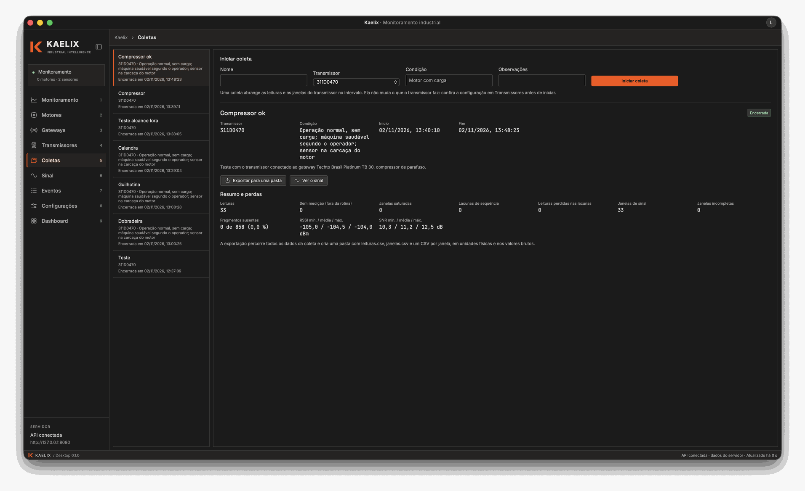
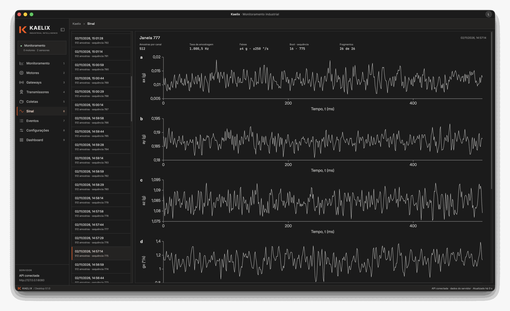
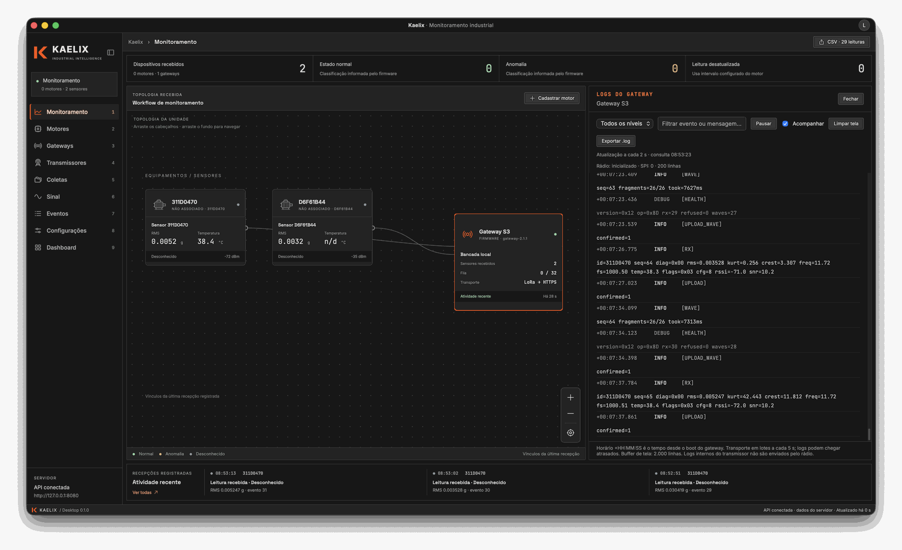

<p align="center">
  
</p>

# Kaelix · Industrial Intelligence

O Kaelix monitora a vibração de motores industriais. Um transmissor ESP32-C3 com sensor inercial mede aceleração e velocidade angular em três eixos, a 1 kHz, e envia por rádio LoRa os indicadores de cada janela de medição e o sinal bruto a um gateway ESP32-S3. O gateway entrega esses dados por HTTPS a uma API em Go, que os grava em PostgreSQL no computador levado a campo. O aplicativo de mesa mostra a telemetria, configura gateway e transmissor sem cabo e organiza as coletas.

Este repositório contém a API, o aplicativo de mesa e os contratos que os dois compartilham com o firmware. O firmware está em [kaelix-firmware](https://github.com/LauanMath/kaelix-firmware).



<sub>Monitoramento durante a coleta em campo de 2 de novembro de 2026. O sensor 311D0470 mediu 0,2824 g RMS e 42,3 °C, e o painel à direita mostra o histórico de vibração dos últimos 15 minutos.</sub>

## Como funciona



<sub>**O transmissor só se comunica com o gateway, e o gateway só alcança as rotas de gateway da API.** Diagrama de blocos da montagem em campo, com as portas padrão da configuração. Tracejado vermelho-alaranjado: rádio LoRa. Contínuo azul: rede Wi-Fi local, com HTTPS. Pontilhado cinza: comunicação dentro do computador. A seta parte de quem inicia a comunicação.</sub>

O rádio usa dois canais. O canal de controle (433 MHz, fator de espalhamento 9, banda de 125 kHz) é fixo no firmware, e nenhuma configuração remota o altera. Por ele, o transmissor envia a telemetria de cada ciclo, e o gateway responde com confirmação, hora UTC, configuração nova e comando pendente. O sinal bruto segue depois, em rajada, num perfil de taxa maior, escolhido na configuração. No perfil padrão (fator 7, 250 kHz, 10,94 kbps), uma janela de 512 amostras nos seis canais leva 5,1 s de transmissão. O gateway devolve o mapa dos fragmentos recebidos, e o transmissor reenvia os que faltaram, em até duas rodadas.

O gateway grava em flash o que recebe e só apaga o que a API confirmou. Enquanto a rede ou a API estiverem fora do ar, as leituras esperam nessa fila, limitada pela capacidade da flash. O gateway encontra a API pelo anúncio `_kaelix._tcp` na rede local (mDNS) e só aceita o certificado cuja impressão digital SHA-256 recebeu no pareamento. As senhas de Wi-Fi guardadas na API ficam cifradas com AES-256-GCM.

A API escuta em até três endereços, cada um com as rotas de um cliente:

| Variável | Padrão | Protocolo | Rotas | Cliente |
|---|---|---|---|---|
| `API_ADDR` | `127.0.0.1:8080` | HTTP | todas | aplicativo de mesa, no mesmo computador |
| `API_GATEWAY_ADDR` | `0.0.0.0:8443` | HTTPS | gateway e `/healthz` | gateways na rede local |
| `API_WEB_ADDR` | desligado | HTTPS | login, leituras, coletas e configuração do transmissor | página de coleta no celular, por exemplo em `0.0.0.0:8444` |

Uma configuração enviada ao transmissor passa por três estados no aplicativo: pendente, quando foi salva na API; enviada pelo rádio, quando o gateway a transmitiu; e aplicada, só quando a telemetria do transmissor relata a versão nova.

## Telas

### Transmissores



<sub>Configuração do transmissor 311D0470 na versão 8: salva às 08:49:20, enviada pelo rádio às 08:49:56 e aplicada às 08:50:06. O formulário mostra o tempo calculado do ciclo (8,66 s) e o intervalo mínimo com esses valores (9 s); a API recusa intervalos menores.</sub>

A configuração cobre a medição (intervalo do ciclo, amostras por canal, canais gravados, faixas do acelerômetro e do giroscópio, filtro do sensor), o rádio (potência, perfil de rajada, frequência do sinal bruto) e a rotina, que define as janelas de horário em que o transmissor mede. Fora dessas janelas, ele dorme e acorda a cada `checkin_interval_s` segundos para pedir comandos. Os comandos Capturar agora, Reiniciar e Restaurar padrões de fábrica seguem pelo mesmo caminho da configuração.

### Gateways



<sub>Estado do gateway S3 informado pelo heartbeat: fila em flash com 133 KiB de 9 101 KiB, 25 leituras e 24 janelas confirmadas na sessão. O nome da rede Wi-Fi e o endereço IP foram ocultados nesta imagem.</sub>

O assistente Adicionar gateway faz o pareamento sem cabo. Sem rede conhecida por 30 s, o gateway abre a própria rede Wi-Fi, `Kaelix-XXXX`, no endereço `192.168.4.1`. O computador entra nessa rede, e o aplicativo lê as redes que o gateway enxerga e envia a escolhida, o token do gateway, a impressão digital do certificado e uma chave de administração. A chave de administração fica no banco local do aplicativo e autoriza um novo pareamento; sem ela, é preciso segurar o botão BOOT do gateway por 10 s. A mesma tela envia firmware novo ao gateway, que volta sozinho à versão anterior se a nova não confirmar a inicialização.

### Coletas



<sub>Coleta "Compressor ok", de 13:40:10 a 13:48:23 em 2 de novembro de 2026: 33 leituras e 33 janelas de sinal, sem lacuna de sequência e sem fragmento ausente (0 de 858).</sub>

Uma coleta marca um intervalo de um transmissor, com nome, condição da máquina e observações, e não muda o que o transmissor faz. O resumo conta leituras, janelas, lacunas de sequência e fragmentos ausentes, com RSSI e SNR mínimos, médios e máximos. A exportação cria uma pasta com `leituras.csv`, `janelas.csv` e um CSV por janela, em unidades físicas e nos valores brutos do sensor.

### Sinal



<sub>Janela 777, de 2 de novembro de 2026, 14:57:14: 512 amostras por canal a 1 000,5 Hz, faixas de ±4 g e ±250 °/s, 26 de 26 fragmentos recebidos.</sub>

Cada canal da janela escolhida tem um gráfico próprio. As amostras de um fragmento perdido chegam como zero; o gráfico as mostra em faixa cinza, e a exportação as deixa vazias.

### Logs do gateway



<sub>Logs do gateway S3 ao lado da topologia, com recepções pelo rádio (RX), janelas completas (WAVE) e confirmações da API (UPLOAD e UPLOAD_WAVE).</sub>

No modo de desenvolvedor, o painel consulta a API a cada 2 s e mantém até 2 000 linhas, com filtro por nível e exportação em `.log`. O gateway envia os logs em lotes a cada 5 s, e os logs do transmissor não passam pelo rádio.

As demais telas cobrem o cadastro de motores e a associação de sensores (Motores), as últimas 50 recepções (Eventos), um painel de indicadores (Dashboard) e a conexão com a API (Configurações). Nenhuma tela usa dados fictícios. Sem resposta da API, o aplicativo mantém a última consulta, marcada como desatualizada.

## Executar

Requisitos: Go 1.26.6 ou mais novo, Node.js 20.19+ ou 22.12+ com npm, Wails CLI 2.13 e PostgreSQL 16 ou mais novo. Com Docker, o Compose já traz o PostgreSQL 18.

### API em contêiner

```sh
cp deploy/.env.example deploy/.env
# Preencha POSTGRES_PASSWORD, API_ADMIN_EMAIL e API_ADMIN_PASSWORD (12 a 72 bytes).
docker compose --env-file deploy/.env -f deploy/compose.yaml up --build -d
curl --fail http://127.0.0.1:8080/readyz
```

O contêiner não anuncia a API por mDNS, e o gateway não a encontra sozinho. Para a montagem em campo, use o serviço do macOS.

### API como serviço do macOS

```sh
cp deploy/.env.example deploy/.env.service
# Preencha DATABASE_URL e a conta inicial, na seção do serviço nativo.
./scripts/install-launchagent.sh
```

O serviço inicia no login, reinicia se parar e impede o Mac de dormir enquanto estiver na tomada. O instalador para se não houver um serviço PostgreSQL do Homebrew em execução. Libere a porta 8443 no firewall do macOS, por onde os gateways chegam à API. O certificado e a chave das senhas de Wi-Fi ficam em `API_DATA_DIR` (padrão: `~/Library/Application Support/Kaelix/api`); apagar essa pasta obriga a parear todos os gateways de novo.

### Aplicativo de mesa

```sh
cd apps/desktop
wails dev     # desenvolvimento
wails build   # executável em build/bin
```

Em Configurações, informe o e-mail e a senha da conta da API; o endereço padrão é `http://127.0.0.1:8080`. A senha não é salva, e a sessão vale por 30 dias.

## Testes

```sh
(cd packages/contracts && go test ./...)
(cd apps/server && go test ./...)        # sem banco, os testes que usam PostgreSQL são pulados
./scripts/test-server-postgres.sh        # API contra um PostgreSQL descartável
(cd apps/desktop/frontend && npm ci && npm run build)
(cd apps/desktop && go test ./...)       # depois do build do frontend, que gera frontend/dist
```

## Estrutura

```text
apps/desktop/         aplicativo de mesa: backend Go e interface React/TypeScript (Wails 2)
apps/server/          API em Go com PostgreSQL
packages/contracts/   tipos Go e schemas JSON do contrato com o gateway
deploy/               Docker Compose, variáveis de ambiente e LaunchAgent do macOS
scripts/              instalação do serviço, teste com PostgreSQL e ícone do aplicativo
docs/                 especificação do enlace, arquitetura, identidade visual e imagens
```

## Documentação

- [Comando e coleta sem cabo](docs/comando-e-coleta.md): rádio, configuração do transmissor e do gateway, pareamento e rotas. É a fonte comum do firmware e desta aplicação.
- [API](apps/server/README.md): execução, endpoints, autenticação e verificação.
- [Aplicativo de mesa](apps/desktop/README.md): pareamento, exportação, logs e perfil local.
- [Contrato HTTP do gateway](packages/contracts/gateway-v1/README.md).
- [Arquitetura e histórico das etapas](docs/arquitetura-desktop-internet.md).
- [Identidade visual](docs/identidade-visual.md).

## Limites atuais

- Os quadros de rádio levam CRC-16, que detecta corrupção, mas não são autenticados.
- Uma telemetria perdida no ar não é reenviada. Sem ela, o gateway não autoriza a rajada, e a leitura e a janela daquele ciclo se perdem; a falta aparece como lacuna de sequência.
- Só o gateway recebe firmware sem cabo; o transmissor é atualizado por cabo.
- A página de coleta usa certificado autoassinado, e o navegador do celular mostra um aviso na primeira visita.
- O serviço da API é um LaunchAgent: depois de um reinício, só volta quando alguém faz login no Mac.

## Licença

O código está sob a licença MIT ([LICENSE](LICENSE)). Os dados da coleta em campo e os resultados das análises ficam no repositório `kaelix-firmware`, sob a licença Creative Commons Atribuição 4.0 Internacional.

Mantêm a licença de origem:

- as fontes Inter, JetBrains Mono e Space Grotesk, em `apps/desktop/frontend/public/fonts/`, e Nunito, em `apps/desktop/frontend/src/assets/fonts/`, sob a SIL Open Font License 1.1, com o texto ao lado de cada fonte;
- os arquivos do modelo do Wails: `apps/desktop/frontend/wailsjs/`, gerado por ele, os modelos de empacotamento em `apps/desktop/build/darwin/` e `apps/desktop/build/windows/` (os ícones são do Kaelix) e `apps/desktop/frontend/src/assets/images/logo-universal.png`, sob a licença MIT do projeto Wails.
