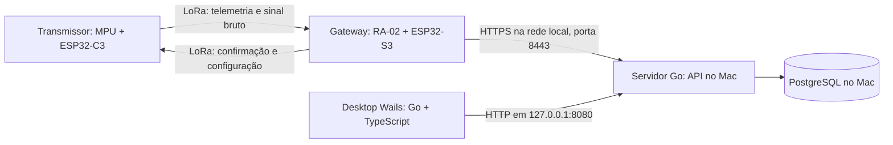

# Arquitetura da aplicação desktop

Arquitetura e estado de implementação. O enlace de comando e coleta está especificado em
[Comando e coleta sem cabo](comando-e-coleta.md), que é o contrato com o firmware e prevalece sobre o
que este documento registrar de etapas anteriores.

Stack escolhida pelo usuário: **Wails, Go e TypeScript**, com aplicação desktop multiplataforma.

## Montagem

O computador vai a campo ligado à tomada, na mesma rede Wi-Fi do gateway. Não há túnel nem nuvem: a API
e o PostgreSQL rodam no próprio Mac.



O gateway encontra o Mac por mDNS (`_kaelix._tcp`) e fixa o certificado próprio pela impressão digital
recebida no pareamento. O servidor recebe leituras com o desktop fechado, mas precisa do Mac ligado. Até
lá, o gateway grava em flash o que recebe e só apaga o que a API confirmou.

O desktop consulta a API a cada 2 segundos enquanto a tela está aberta. Consultas de histórico são
paginadas e feitas sob demanda.

## Responsabilidades

| Componente | Responsabilidade |
|---|---|
| Transmissor C3 | Coletar vibração, calcular indicadores, transmitir telemetria e sinal bruto, executar configuração e comandos |
| Gateway S3 | Validar quadros, registrar metadados de recepção, gravar em flash, conectar ao Wi-Fi, enviar ao servidor e repassar configuração |
| API Go | Autenticar gateway/usuário, validar contrato, persistir, evitar duplicação por reenvio e servir consultas |
| PostgreSQL | Guardar cadastro de motores, dispositivos, gateways, medições e eventos |
| Go do Wails | Cliente da API, sessão do usuário, atualização periódica, cancelamento de requisições e exportação |
| TypeScript | Telas, gráficos, filtros e apresentação dos estados recebidos do Go |

O código Go do desktop chama a API por um cliente HTTP com timeout e contexto. A interface chama métodos Go pelos bindings do Wails. Requisições não bloqueiam a interface; a rotina de atualização é cancelada quando a tela ou aplicação fecha. O servidor é um executável separado do desktop.

## Tecnologias propostas

- **Desktop:** Wails + Go + TypeScript; escolha do framework de interface e versão principal do Wails na preparação do projeto.
- **Servidor:** Go com `net/http`, validação explícita e camadas pequenas de serviço/repositório.
- **Persistência central:** PostgreSQL, com migrações SQL versionadas.
- **Gateway:** manter Arduino/PlatformIO e acrescentar Wi-Fi, cliente HTTPS e fila; sem migrar o firmware inteiro para outro SDK.
- **Servidor:** API e banco locais, no Mac de campo, instalados como serviço por `scripts/install-launchagent.sh`.

## Contrato gateway → servidor

O gateway acrescenta metadados ao converter a leitura para JSON. O contrato HTTP tem sua própria versão, independente da versão LoRa. O pacote atual é o v3, descrito na [especificação](comando-e-coleta.md); o v2 de 21 bytes continua aceito, e o exemplo abaixo é desse formato.

Exemplo ilustrativo de uma requisição:

```json
{
  "schema_version": 1,
  "gateway_id": "5ef49647-9449-4f47-8d1d-c06611c3ba81",
  "gateway_session_id": "17162ec5-4fe1-4dac-a871-879120324a57",
  "upload_uptime_ms": 13000,
  "readings": [
    {
      "event_seq": 1,
      "gateway_rx_uptime_ms": 12000,
      "gateway_received_at": null,
      "packet_version": 2,
      "device_id": "D6F61B44",
      "device_sequence": 1,
      "state": "UNKNOWN",
      "diag_code": 0,
      "rms_g": 0.003598,
      "temperature_c": null,
      "rssi_dbm": -55.0,
      "snr_db": 13.5,
      "packet_crc16": 12345
    }
  ]
}
```

O valor de CRC é apenas ilustrativo. Pacotes sem CRC válido não entram no caminho de medições; sua rejeição aparece nos contadores do gateway. A API valida tipos, versão, estados conhecidos, números finitos e limites de lote; não confia apenas na validação do gateway.

### Valores ausentes e limites do pacote atual

- Converter NaN para `null` no JSON, sem substituir por zero.
- `UNKNOWN` significa classificação indisponível; não equivale a motor normal.
- `diag=OK` significa ausência de erro reportado no ciclo; não valida o modelo para o motor.
- O pacote v2 transmite só RMS e temperatura. O v3 acrescenta curtose, fator de crista e frequência dominante, e a forma de onda chega em janelas separadas.
- RMS em g é aceleração; não apresentar como velocidade em mm/s ou comparar diretamente com limites de velocidade.

### Identidade, sequência e horário

`device_id` identifica o sensor e é associado a um motor no cadastro. Dispositivos ainda não cadastrados aparecem como “não associados”, preservando as leituras para posterior associação.

`device_sequence` é o `boot_count` do pacote atual. No ambiente de bancada ele incrementa por ciclo e pode voltar a 1 após reset. Por isso, **não usar `(device_id, device_sequence)` como chave única permanente**.

O gateway tem identidade cadastrada e uma sessão nova a cada boot, gerada com UUID aleatório em minúsculas. `event_seq` incrementa por pacote validado, dentro dessa sessão. A chave `(gateway_id, gateway_session_id, event_seq)` identifica o evento de recepção e permanece igual em todas as tentativas de envio desse evento.

O servidor registra `ingested_at` em UTC. O gateway acerta o relógio pela sincronização com a API; `gateway_received_at` fica `null` se o relógio não era confiável na recepção. A tela distingue horário de recepção no gateway de horário de chegada ao servidor: nenhum deles deve ser rotulado como horário exato de aquisição no motor.

`upload_uptime_ms - gateway_rx_uptime_ms` informa o atraso na fila na mesma sessão. Esse atraso evita que uma leitura antiga reenviada após queda da rede seja apresentada como medição fresca. Timestamps monotônicos devem usar contador de 64 bits e não atravessar resets.

## Entrega e reconexão no gateway

1. A tarefa de rádio valida a leitura e a grava em flash antes de enviar.
2. Uma tarefa de rede consome a fila e envia lotes de até 8 leituras por HTTPS, com timeout e retentativas espaçadas.
3. O servidor confirma os eventos somente depois de persistir a transação.
4. O gateway remove apenas os eventos confirmados. Se uma resposta se perder, envia os mesmos identificadores novamente; a API reconhece duplicatas sem criar novas medições.

O acesso SPI fica restrito à tarefa do rádio. Wi-Fi, TLS e requisições HTTP não rodam dentro da ISR nem bloqueiam o loop de recepção. Depois de um reinício, o que ficou em flash segue com `previous_session`, sem atraso de fila calculado.

A confirmação HTTP cobre **gateway → servidor**. O trecho **transmissor → gateway** tem a resposta do ciclo e o mapa da rajada, descritos na [especificação](comando-e-coleta.md).

## API inicial

| Método e caminho | Uso |
|---|---|
| `POST /api/v1/ingest/readings` | Receber lote e retornar eventos confirmados/duplicados |
| `POST /api/v1/ingest/heartbeat` | Receber sessão, uptime, ocupação da fila e contadores do gateway |
| `POST /api/v1/auth/login` | Iniciar sessão do usuário do desktop |
| `GET /api/v1/motors` | Listar motores e últimas leituras disponíveis |
| `POST /api/v1/motors` | Cadastrar motor e vincular dispositivo |
| `GET /api/v1/motors/{id}/readings` | Consultar histórico por período e cursor, com limite |
| `GET /api/v1/gateways` | Consultar última atividade e saúde dos gateways |
| `GET /api/v1/events` | Consultar eventos técnicos e alertas registrados |

O gateway usa credencial própria com permissão apenas de ingestão; a API confere que `gateway_id` corresponde à credencial. O desktop usa sessão de usuário com permissões de consulta/cadastro. O gateway fala por HTTPS e fixa o certificado pela impressão digital. Credenciais ficam fora do repositório e dos logs; nenhuma credencial de banco vai no firmware ou no desktop.

## Modelo de dados

- **Motor:** identificador interno, nome, localização, dispositivo associado e intervalo esperado de leitura.
- **Dispositivo:** ID LoRa, associação ao motor, perfil conhecido e observações de validação.
- **Gateway:** identidade, local, sessão atual, último heartbeat e contadores.
- **Medição:** identidade do evento, dispositivo, sequência do dispositivo, horários e atraso de fila, RMS, temperatura, estado, diagnóstico, RSSI e SNR.
- **Evento:** perda observada de sequência, reset aparente, desconexão, rejeições e alertas de estado.
- **Usuário:** credenciais protegidas e permissões para acesso à API.

Guardar os dados de recepção mesmo quando houver campos ausentes; gráficos pulam valores `null` e indicam lacunas. Índice de histórico por dispositivo/tempo e chave única da identidade de evento. O MVP trabalha com um gateway por local; deduplicar recepções do mesmo pacote em múltiplos gateways exige decisão adicional e não é resolvido pela chave de evento acima.

## Experiência desktop

O frontend do Wails deve funcionar como área de trabalho: navegação lateral,
barra de comandos compacta, painéis ajustados à janela e barra de estado.
A rolagem pertence às listas e aos painéis, sem rolagem global de página.
No macOS, manter os controles nativos da janela e integrar o cabeçalho à barra
superior. Áreas de trabalho acessíveis pelo menu nativo e por Ctrl/⌘ + 1 a 9 e 0.
A referência local de organização da interface é o projeto TERRA-Open-Energy;
a direção visual industrial continua baseada nas imagens fornecidas.

## Telas do desktop

1. **Conexão e acesso:** endereço do servidor, login e estado da conexão.
2. **Visão dos motores:** nome, última leitura, RMS, temperatura disponível, diagnóstico e idade da medição.
3. **Detalhe do motor:** gráfico de RMS por período, histórico, sequência e qualidade do enlace.
4. **Gateways:** última atividade, falhas SPI, rejeições e fila pendente, quando esses contadores forem enviados.
5. **Cadastro:** associação dispositivo → motor e intervalo esperado.
6. **Exportação:** CSV de um período, com unidades, horário UTC e campos ausentes explícitos.

Manter separados: **conexão desktop → API**, **conexão gateway → API**, **atualidade das leituras do sensor** e **classificação do motor**. API inacessível não significa motor defeituoso; gateway online não garante chegada dos sensores; classificação desconhecida não significa normal.

Proposta de ausência de leitura: três intervalos esperados mais uma margem configurável, usando idade estimada da recepção e atraso na fila. Os intervalos de bancada (~11 s) e de campo (12 minutos mais jitter) precisam de configurações distintas. Reinício ou lacuna de sequência vira evento técnico, sem afirmar perda exata quando não há sessão do sensor no pacote atual.

## Organização proposta no repositório

```text
apps/
  desktop/                # Wails, Go e frontend TypeScript
  server/                 # Executável Go da API
packages/
  contracts/              # DTOs Go e exemplos de contrato HTTP
deploy/
  compose.yaml            # Ambiente local de API + PostgreSQL
                          # O firmware fica no repositório kaelix-firmware
```

O servidor importa DTOs Go compartilhados em `packages/contracts`; o cliente do
desktop utiliza o mesmo contrato pelo backend Go do Wails. Migrações centrais ficam embutidas
em `apps/server/internal/store/migrations`. O frontend usa bindings gerados pelo Wails; testes de contrato verificam o JSON emitido pelo gateway. Dependências Go/TypeScript ficam separadas do projeto Python de treinamento já existente.

## Etapas e critérios de aceite

1. **Contrato e API:** persistência, autenticação, reenvio idempotente, `null` e `UNKNOWN` preservados.
2. **Desktop:** cadastro, últimas leituras, histórico e exportação; interface responsiva ao desconectar o servidor.
3. **Comando e coleta:** configuração, comandos, janelas, coletas e pareamento sem cabo, conforme a [especificação](comando-e-coleta.md).
4. **Integração em campo:** transmissor → gateway → API → banco → desktop, com o desktop fechado durante parte da coleta.
5. **Ensaios:** queda de Wi-Fi e da API, resposta perdida, reinício e fila cheia; medir entrega, latência e descartes.

## Fontes técnicas consultadas

- [Wails: arquitetura e bindings Go/JavaScript](https://wails.io/docs/howdoesitwork/).
- [Wails: suporte e funcionalidades](https://wails.io/docs/introduction/).
- [Go: cliente e servidor HTTP](https://pkg.go.dev/net/http).
- [Espressif: cliente HTTP/HTTPS no ESP-IDF](https://docs.espressif.com/projects/esp-idf/en/stable/esp32s3/api-reference/protocols/esp_http_client.html). Referência de capacidades do chip/SDK; o projeto usa Arduino, sem mudança de framework.

## Persistência local implementada

O desktop tem SQLite para um perfil local (nome, e-mail, empresa e cargo).
Migrações ficam em `apps/desktop/internal/store/migrations` e são aplicadas
transacionalmente. Esse perfil não autentica acesso à API. PostgreSQL central está implementado no servidor para contas administrativas,
sessões, motores, dispositivos, gateways e medições.

## API e banco central implementados

O ponto **API Go + banco central: ingestão, histórico e cadastro de dispositivos**
está implementado em `apps/server`, com PostgreSQL e DTOs em `packages/contracts`.
Execução, exemplos e limites do contrato estão no [guia da API](../apps/server/README.md).

- Migração versionada e transacional, serializada entre instâncias.
- Cadastro e atualização de dispositivos/motores, vínculo único e preservação de sensores não associados.
- Cadastro de gateways com credencial própria, armazenada por hash e passível de rotação.
- Login administrativo com bcrypt, sessões revogáveis e separação de permissões de usuário/gateway.
- Lotes v1 de até oito leituras: commit antes da confirmação, reenvio idempotente e rollback integral em conflito.
- Preservação de `null`/`UNKNOWN`, atraso de fila e distinção dos horários de ingestão/recepção estimada.
- Últimas leituras, histórico por período/cursor e último heartbeat de cada gateway.
- Testes com PostgreSQL real para persistência, concorrência, autenticação e contrato.

A tabela “API inicial” acima contém também endpoints previstos: `/events` permanece
pendente. Cadastro de dispositivos e rotação de credenciais estão detalhados no guia.
O frontend utiliza o cliente Go da API, com sessão autenticada e consultas reais.

### Alinhamento com o contrato do firmware

A fronteira de ingestão adota o contrato em
`kaelix-firmware/docs/contracts/gateway-v1`, copiado para
`packages/contracts/gateway-v1` neste repositório e estendido pela especificação. Estados de protocolo são
`NORMAL`, `ANOMALOUS` e `UNKNOWN`; sequência do sensor é uint32. Confirmações
versionadas usam `acknowledged` com `stored`/`duplicate`; erros incluem código,
`retryable` e detalhes. Ingestão limita corpo a 32 KiB e rejeita chaves duplicadas.

O heartbeat inclui sequência, versão de firmware, saúde e contadores. Snapshots
repetidos/antigos não renovam atividade ou regridem o estado; sessões aposentadas
não substituem a ativa. A escolha inicial da sessão usa ordem de primeira recepção
no servidor: UUID sozinho não ordena boots de sessões nunca antes observadas.
A política e essa limitação estão documentadas no guia da API. Migração 002
preserva os dados e arquiva snapshots do formato anterior de heartbeat.

## Desktop conectado aos dados reais

O backend Wails (`app_api.go` e `internal/apiclient`) autentica, carrega cadastros,
gateways e últimas recepções em paralelo, com timeout e cancelamento. Polling da
interface ocorre a cada dois segundos, sem sobreposição; históricos são consultados
quando o sensor/período/última medição muda. URL e sessão ficam no SQLite privado,
com migração 003; senha nunca é persistida. Logout revoga a sessão e remove o token.

`frontend/src/lib/demo.ts` foi removido. Sensores não associados são exibidos pelo
ID recebido e podem ser cadastrados/vinculados a motores. Workflow usa quantidade
real de sensores/gateways e vínculo da última recepção. Dashboard e indicadores
usam os mesmos dados; a aba Eventos mostra recepções persistidas (`/readings/recent`),
sem criar alertas de classificação ou conexão fictícios.

Histórico usa período/cursor e unidades originais; CSV exporta as leituras carregadas
com horários distintos de recepção/ingestão. Falha da API indica explicitamente a
última consulta preservada; campos ausentes não são preenchidos com zeros. Não há
substituição por dados simulados. Conta da API e perfil de exibição local continuam
separados.
