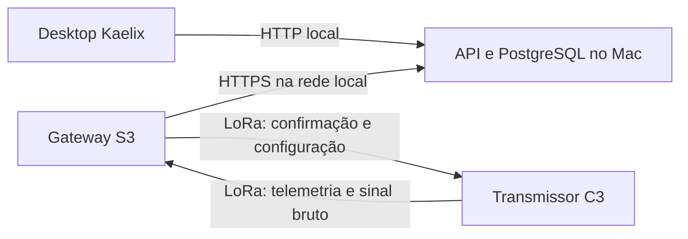

# Comando e coleta sem cabo

Especificação do enlace Kaelix (desktop), gateway ESP32-S3 e transmissor ESP32-C3. É a fonte comum do firmware e da aplicação: uma mudança aqui exige mudar os dois lados.

## Montagem

O computador vai a campo, ligado à tomada, na mesma rede Wi-Fi do gateway. Nada usa cabo depois da primeira gravação do firmware.



- A API escuta em dois endereços. `127.0.0.1:8080`, HTTP, com todas as rotas, para o desktop. `0.0.0.0:8443`, HTTPS, só com as rotas de gateway e `/healthz`, para a rede local.
- O certificado é próprio e o gateway o fixa pela impressão digital SHA-256 recebida na configuração inicial. Assim, o token, a senha do Wi-Fi e os comandos não trafegam em claro numa rede de terceiros.
- A API anuncia o serviço `_kaelix._tcp` por mDNS, na porta 8443. O gateway encontra o Mac por esse anúncio, sem IP gravado.

## Princípios, herdados de sondas sem acesso físico

1. **O enlace é opcional para medir.** O transmissor executa a configuração gravada, com ou sem gateway.
2. **O canal de controle nunca muda.** 433 MHz, SF9, BW125, CR 4/5, sincronismo 0x12, fixos no firmware. Nenhuma configuração remota pode isolar o dispositivo.
3. **Comando só é "aplicado" quando a telemetria confirma.** O desktop distingue pendente, enviado pelo rádio e aplicado.
4. **Perda de comando tem resposta automática.** Sem resposta do gateway por `link_loss_s`, o transmissor reverte a configuração ainda não confirmada e sobe a potência ao máximo. Continua medindo.
5. **Nada se perde por falta de rede.** O gateway grava em flash antes de enviar e só apaga o que a API confirmou. A API é idempotente.

## Rádio

Todos os quadros são little-endian e empacotados. O primeiro byte é a versão do protocolo (`3`), o segundo é o tipo, e os dois últimos são o CRC-16/CCITT de todos os bytes anteriores. O código de referência é `lib/kaelix_protocol/kaelix_protocol.h`, no firmware.

| Tipo | Valor | Sentido | Canal | Tamanho |
|---|---|---|---|---|
| Telemetria | 1 | C3 para S3 | controle | 71 bytes |
| Resposta | 2 | S3 para C3 | controle | 22 bytes, mais a configuração |
| Fragmento | 3 | C3 para S3 | rajada | 14 bytes, mais as amostras |
| Mapa da rajada | 4 | S3 para C3 | rajada | 44 bytes |

### Ciclo

1. O C3 adquire a janela e calcula os indicadores.
2. Envia a telemetria. Se houver sinal bruto, ela informa quantos fragmentos virão e em qual perfil.
3. Abre a recepção por até 300 ms. O S3 sempre responde: confirmação, hora UTC, configuração desejada se a versão diferir, e comando pendente.
4. Se a resposta autorizou a rajada, os dois trocam para o perfil de rajada. O C3 envia os fragmentos.
5. O S3 responde com o mapa dos fragmentos recebidos. O C3 reenvia os que faltam, em até 2 rodadas.
6. Os dois voltam ao canal de controle. Uma janela incompleta é entregue assim mesmo, com o mapa do que faltou.

### Perfis de rajada

| Código | SF | BW (kHz) | Taxa (kbps) | 6 canais, 512 amostras |
|---|---|---|---|---|
| 0 | 9 | 125 | 1,76 | 32 s |
| 1 | 7 | 125 | 5,47 | 10,2 s |
| 2 (padrão) | 7 | 250 | 10,94 | 5,1 s |
| 3 | 7 | 500 | 21,88 | 2,6 s |

Os tempos são calculados, só de transmissão. Perfis mais rápidos têm menos alcance. Fluxo contínuo não cabe: 6 canais a 1 kHz geram 96 kbps.

### Canais

Máscara `channels`: bit 0 ax, 1 ay, 2 az, 3 gx, 4 gy, 5 gz. O padrão é `63`, os seis. As amostras são `int16` brutos do sensor, intercaladas na ordem dos bits, na escala informada por `accel_range` e `gyro_range`.

## Configuração do transmissor

| Campo JSON | Tipo | Faixa | Padrão | Significado |
|---|---|---|---|---|
| `version` | int | 1 a 65535 | | Atribuída pela API a cada alteração |
| `cycle_interval_s` | int | 1 a 3600 | 11 | Início de um ciclo ao início do próximo |
| `window_samples` | int | 256, 512, 1024, 2048, 4096 | 512 | Amostras por canal na janela |
| `channels` | int | 1 a 63 | 63 | Máscara acima; precisa incluir `az` (bit 2) |
| `accel_range` | int | 0 a 3 | 1 | ±2, ±4, ±8, ±16 g |
| `gyro_range` | int | 0 a 3 | 0 | ±250, ±500, ±1000, ±2000 °/s |
| `dlpf` | int | 0 a 6 | 1 | Código do filtro do sensor; 1 é 184 Hz |
| `tx_power_dbm` | int | 2 a 17 | 10 | Potência do rádio |
| `burst_profile` | int | 0 a 3 | 2 | Tabela acima |
| `wave_every` | int | 0 a 255 | 1 | Sinal bruto a cada N ciclos; 0 desliga |
| `link_loss_s` | int | 60 a 86400 | 900 | Silêncio do gateway até a resposta automática |
| `checkin_interval_s` | int | 60 a 3600 | 300 | Fora da rotina, intervalo para pedir comandos |
| `tz_offset_min` | int | -720 a 840 | -180 | Fuso das janelas da rotina |
| `routine` | lista | até 6 itens | vazia | Vazia significa sempre ligado |

Cada item de `routine` tem `days` (máscara, bit 0 é domingo), `start_min` e `end_min` (minutos do dia, 0 a 1440). `end_min` menor que `start_min` atravessa a meia-noite. Fora das janelas, o transmissor dorme e acorda a cada `checkin_interval_s`, transmitindo uma telemetria sem medição (`flags` bit 4).

A janela precisa caber no ciclo. A API rejeita a configuração se o tempo calculado ultrapassar `cycle_interval_s`, e informa o intervalo mínimo. O cálculo, em segundos:

- Aquisição: `window_samples / 1000 + 0,3`.
- Controle: 0,411 da telemetria mais 0,711 da espera e da resposta com configuração.
- Fragmentos, se `wave_every` for maior que 0: cada um leva até `240 - (240 mod c)` bytes de amostras, com `c = 2 × canais`, mais 14 de cabeçalho e CRC. Tempo de cada um pela fórmula de LoRa abaixo, mais 0,05 de intervalo. Mais 0,3 para o mapa da rajada.

`tempo = (12,25 + n) × 2^SF / BW`, com BW em kHz e o tempo em ms, e `n = 8 + máx(teto((8·P - 4·SF + 44) / (4·SF)) × 5, 0)`, para P bytes.

Conversão para unidades físicas: aceleração em g é `bruto / (16384 / 2^accel_range)`; velocidade angular em °/s é `bruto / (131 / 2^gyro_range)`.

Comandos pontuais em `kind`: `reboot`, `factory_reset`, `capture_now`. Cada comando tem `seq` crescente por dispositivo (1 a 65535), e o transmissor devolve o último executado em `command_seq` na telemetria. Ao criar um `factory_reset`, a API também troca a configuração desejada pelos padrões da tabela acima, com versão nova, para que a configuração antiga não volte sozinha.

## Configuração do gateway

| Campo JSON | Tipo | Significado |
|---|---|---|
| `version` | int | Atribuída pela API |
| `wifi` | lista, até 5 | `{ssid, password}`; o gateway tenta em ordem de sinal |
| `heartbeat_interval_s` | int, 10 a 300 | Padrão 30 |
| `sync_interval_s` | int, 2 a 60 | Padrão 5 |
| `ap_when_offline` | bool | Abrir a rede própria sem Wi-Fi conhecido; padrão `true` |
| `tx_power_dbm` | int, 2 a 17 | Potência da resposta pelo rádio; padrão 17 |

## Configuração inicial, sem cabo

Sem rede conhecida por 30 s, o gateway abre a rede `Kaelix-XXXX` (últimos 4 dígitos do MAC), senha `kaelix-XXXX`, endereço `192.168.4.1`, e continua recebendo o rádio e gravando em flash. Ele expõe, em HTTP:

| Rota | Autorização | Uso |
|---|---|---|
| `GET /info` | nenhuma | `{mac, firmware_version, gateway_id, paired, connected, ssid, ip, config_version}` |
| `GET /scan` | nenhuma | `{networks:[{ssid, rssi, secure}]}` |
| `POST /provision` | `X-Kaelix-Admin`, se já pareado | Corpo abaixo |
| `POST /reboot` | `X-Kaelix-Admin` | Reinicia |

```json
{
  "gateway_id": "uuid",
  "gateway_token": "43 caracteres",
  "admin_key": "64 caracteres hexadecimais",
  "tls_sha256": "64 caracteres hexadecimais",
  "wifi": [{"ssid": "rede", "password": "senha"}]
}
```

Segurar o botão BOOT por 10 s apaga o pareamento. No desktop, o assistente é: criar o gateway na API, pedir que o usuário entre na rede `Kaelix-XXXX`, ler `/info` e `/scan`, escolher o Wi-Fi local, enviar `/provision`, acompanhar `/info` até `connected`, pedir a volta ao Wi-Fi local e aguardar o primeiro heartbeat.

## HTTP do gateway

Todas as rotas usam `Authorization: Bearer <token>`. `POST /api/v1/ingest/readings`, `/heartbeat` e `/logs` seguem o contrato `gateway-v1`, com estes acréscimos.

### Leituras

`packet_version` aceita `2` e `3`. Campos opcionais em cada leitura, todos nulos ou ausentes no pacote v2:

`boot_count` (uint32), `command_seq` (uint16), `rms_x_g`, `rms_y_g`, `kurtosis`, `crest_factor`, `dominant_freq_hz`, `sample_rate_hz` (números), `config_version` (uint16), `reset_reason` (uint8), `flags` (uint8), `device_time` (RFC 3339 UTC ou nulo), `uptime_s` (uint32), `wave_fragments` (uint8), `wave_samples` (uint16), `channels` (uint8), `tx_power_dbm` (int8).

`temperature_c` passa a trazer a temperatura interna do sensor.

Bits de `flags`: 0 hora sincronizada; 1 sinal bruto a seguir; 2 resposta automática ativa; 3 configuração rejeitada; 4 sem medição (fora da rotina); 5 janela saturada.

No lote, `previous_session` (bool, opcional): os eventos são de um boot anterior do gateway, lidos da flash. Nesse caso, `upload_uptime_ms` é o maior `gateway_rx_uptime_ms` do lote, a API grava `queue_delay_ms` 0 e, sem `gateway_received_at`, deixa `estimated_received_at` nulo.

Ao gravar uma leitura com `config_version`, a API atualiza a versão relatada do dispositivo. O `reported` é o que marca a configuração como aplicada.

### Heartbeat

Campos opcionais acrescentados. Em `health`: `spool_used_bytes`, `spool_capacity_bytes` (inteiros), `ssid`, `ip`, `reset_reason` (textos, até 64 caracteres). Em `counters`: `spool_dropped`, `waveforms_acknowledged` (inteiros que não diminuem na sessão). As demais regras e o formato da resposta não mudam.

### `POST /api/v1/ingest/waveforms`

Limite de corpo: 128 KiB. Idempotente por `(gateway_id, gateway_session_id, event_seq)`. `event_seq` é o da leitura correspondente.

```json
{
  "schema_version": 1,
  "gateway_id": "uuid",
  "gateway_session_id": "uuid",
  "previous_session": false,
  "upload_uptime_ms": 13000,
  "event_seq": 21,
  "gateway_rx_uptime_ms": 12000,
  "gateway_received_at": "2026-11-02T04:59:22Z",
  "device_id": "311D0470",
  "device_sequence": 48,
  "boot_count": 2,
  "channels": 63,
  "window_samples": 512,
  "sample_rate_hz": 999.8,
  "accel_range": 1,
  "gyro_range": 0,
  "dlpf": 1,
  "burst_profile": 2,
  "fragment_total": 26,
  "fragments_missing": [3, 17],
  "samples_b64": "..."
}
```

`samples_b64` é o bloco de `int16` little-endian com o tamanho exato de `window_samples` vezes o número de canais vezes 2 bytes. Fragmentos ausentes vêm preenchidos com zero e listados em `fragments_missing`. A resposta segue o formato de `readings`, com `acknowledged` de um item.

### `POST /api/v1/gateway/sync`

Chamado a cada `sync_interval_s`. É também como o gateway acerta o relógio e recebe o que precisa repassar.

```json
{
  "schema_version": 1,
  "gateway_id": "uuid",
  "gateway_session_id": "uuid",
  "config_version": 3,
  "firmware_version": "gateway-2.0.0",
  "ota_result": null,
  "devices": [
    {"device_id": "311D0470", "radiated_config_version": 7, "radiated_command_seq": 2}
  ]
}
```

`radiated_config_version` e `radiated_command_seq` informam o que o gateway já transmitiu pelo rádio. `ota_result` é nulo ou `{"version", "ok", "reason"}`.

Resposta:

```json
{
  "schema_version": 1,
  "gateway_id": "uuid",
  "gateway_session_id": "uuid",
  "server_time": "2026-11-02T04:59:22.120Z",
  "gateway_config": null,
  "devices": [
    {
      "device_id": "311D0470",
      "config": {"version": 7, "cycle_interval_s": 11},
      "command": {"seq": 2, "kind": "capture_now"}
    }
  ],
  "firmware": null
}
```

`gateway_config` só vem quando a versão desejada difere da enviada na requisição, e traz as senhas de Wi-Fi. Em `devices` vêm só os dispositivos com configuração ainda não confirmada pela telemetria ou comando pendente; `config` e `command` podem ser nulos. `firmware` é nulo ou `{"version", "sha256", "size", "path"}`, a baixar por `GET` no `path` com o mesmo token. A versão anterior fica como reserva e volta sozinha se a nova não confirmar a inicialização.

### `GET /api/v1/gateway/firmware/{id}`

Binário do firmware, com autorização do gateway.

## Rotas do desktop

Todas com sessão de usuário.

| Rota | Uso |
|---|---|
| `GET`, `PUT /api/v1/devices/{id}/config` | Configuração desejada, versão relatada, estado (`pending`, `radiated`, `applied`) e horários |
| `POST`, `GET /api/v1/devices/{id}/commands` | Criar e listar comandos, com estado |
| `GET`, `PUT /api/v1/gateways/{id}/config` | Idem para o gateway. O `GET` devolve `has_password`, nunca a senha. Num `PUT`, `password` ausente mantém a atual |
| `GET /api/v1/devices/{id}/waveforms` | Lista paginada, sem as amostras, com `from`, `to`, `cursor`, `limit` |
| `GET /api/v1/waveforms/{id}` | Janela completa, com `samples_b64` |
| `GET`, `POST /api/v1/collections`, `PUT /api/v1/collections/{id}` | Coletas |
| `GET /api/v1/collections/{id}/summary` | Leituras, janelas, lacunas de sequência, fragmentos ausentes, RSSI e SNR |
| `POST`, `GET /api/v1/gateways/{id}/firmware` | Enviar binário e ver o estado da atualização |
| `GET /api/v1/tls/fingerprint` | Impressão digital para a configuração inicial |

Uma **coleta** tem `id`, `name`, `device_id`, `condition`, `notes`, `started_at` e `ended_at`, e abrange as leituras e janelas daquele dispositivo no intervalo.

## Página de coleta

Com `API_WEB_ADDR` definido, a API serve em HTTPS uma página para celular, embutida no programa. Ela inicia e encerra coletas, ajusta o intervalo de captura e mostra o estado do gateway, do transmissor e as últimas leituras. Exige a mesma conta do aplicativo. Serve para deixar o computador parado e andar com o gateway e o transmissor.

## Banco

Migração `005`: `device_configs`, `device_commands`, `gateway_configs`, `waveforms`, `collections`, `gateway_firmware`. Senhas de Wi-Fi ficam cifradas com AES-GCM, com a chave em `API_DATA_DIR/secret.key` (0600). O certificado TLS é gerado na primeira execução, em `API_DATA_DIR`.

## O que o usuário vê

- **Gateways:** estado, rede, fila em flash, assistente "Adicionar gateway", redes Wi-Fi, envio de firmware.
- **Transmissores:** formulário da configuração, editor da rotina, estado pendente, enviado ou aplicado, comandos.
- **Coletas:** iniciar e encerrar com nome e condição, resumo com perdas, exportação completa.
- **Sinal:** gráfico de cada canal da janela escolhida.
- **Exportação:** pasta com `leituras.csv`, `janelas.csv` e um CSV por janela, em unidades físicas e nos valores brutos.

O desktop aponta para `http://127.0.0.1:8080` por padrão.
